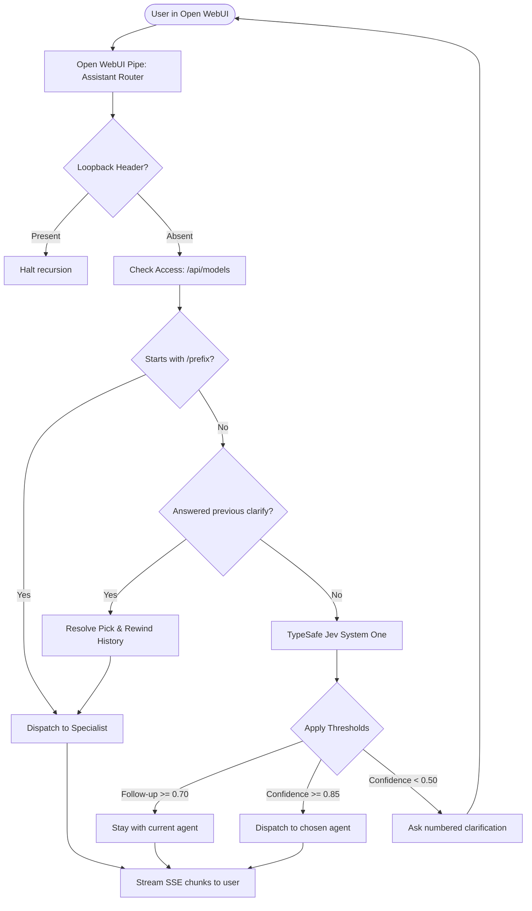

# AI Agent Instructions: Universal Open WebUI Router (TypeSafe Jev)

> **Purpose**: This guide contains complete instructions for an AI coding assistant or human developer to understand, recreate, customize, and deploy this universal router pipe from scratch.

---

## 1. System Overview & Architecture

### What This Does
Open WebUI allows users to pick a model from a dropdown. In an organization or multi-model setup, having users manually select between 5–10 specialized models causes confusion and misrouted queries.

The **Universal Assistant Router** acts as a single "Front Door" model in Open WebUI:
1. Every user query enters the router pipe function.
2. The router evaluates the turn using **TypeSafe Jev** (`https://api.typesafe.ai/v1/systemone`).
3. If confident, it dispatches the turn to the appropriate specialist model via Open WebUI's internal loopback (`/api/chat/completions`) using the user's own session token.
4. If ambiguous, it asks a numbered clarification question and transparently routes the *original* user query once answered.
5. All specialist tokens stream back in real-time, preserving citations and statuses.

### Architectural Flowchart


---

## 2. Core Technical Constraints

When recreating this system, ensure the following hard rules are followed:

1. **Loopback Protection (`HOP_HEADER`)**:
   - Every internal request sent by the pipe to `/api/chat/completions` **must** include the header `X-OWUI-Router: 1`.
   - The pipe **must** check for this header upon entry and abort immediately if present. This prevents catastrophic infinite recursion.

2. **User Identity & Token Forwarding**:
   - The pipe must extract the caller's Bearer token from `__request__` (headers or cookies) and forward it in the loopback request.
   - **Why?** It ensures that Open WebUI's Model Access rules (RBAC / LDAP / user groups) are enforced, and tool calls are bound to the actual caller.

3. **User Access Filter (`/api/models`)**:
   - The pipe queries `GET /api/models` using the caller's token.
   - Models not present in this list are stripped from the router's candidate list before calling Jev.

4. **Single-File Deployable**:
   - Open WebUI functions require a single `.py` file pasted into `Admin → Functions`.
   - Use a build script (`src/build_pipe.py`) that inlines `route.py` and `agents.json` into `pipe_body.py` to produce `dist/router_pipe.py`.

---

## 3. TypeSafe Jev System One Integration

### Why TypeSafe Jev?
Unlike generative LLMs that require verbose prompt engineering, system instructions, and fragile JSON parsing, **TypeSafe Jev** is a System One classifier. It consumes structured state and outputs typed judgments with calibrated probabilities.

### API Contract
- **Endpoint**: `POST https://api.typesafe.ai/v1/systemone`
- **Headers**:
  ```http
  Authorization: Bearer <TYPESAFE_API_KEY>
  Content-Type: application/json
  ```
- **Payload Structure**:
  ```json
  {
    "model": "jev-latest",
    "state": {
      "message": "User's current query",
      "recent_context": "user: previous turn\nassistant: previous answer",
      "current_assistant": "Code & Engineering"
    },
    "questions": {
      "agent": {
        "type": "choice",
        "instructions": "Which assistant should answer `message`? Judge `message` itself; use `recent_context` only to clarify short or ambiguous references.",
        "criteria": {
          "code": { "what": "...", "not_for": "...", "examples": [...] },
          "data": { "what": "...", "not_for": "...", "examples": [...] }
        }
      },
      "follow_up": {
        "type": "noul",
        "instructions": "Is `message` a continuation of the ongoing conversation in `recent_context` (follow-up question, correction, extra detail) rather than a new, unrelated topic?",
        "criteria": {
          "true": "Continues the active topic or references earlier conversation.",
          "false": "Starts a new, independent topic or recent_context is empty."
        }
      }
    }
  }
  ```

### Response Structure
```json
{
  "model": "jev-latest",
  "answers": {
    "agent": {
      "type": "choice",
      "choice": "code",
      "probabilities": { "code": 0.92, "data": 0.05, "general": 0.03 },
      "confidence": 0.89
    },
    "follow_up": {
      "type": "noul",
      "noul": 0.12
    }
  }
}
```

---

## 4. Decision Table & Thresholds

Apply the following deterministic decision cascade:

| Priority | Condition | Action | Rationale |
|---|---|---|---|
| **1** | Message begins with `/prefix` (e.g. `/code`) | **Direct Dispatch** | User explicitly demanded an agent. Zero router latency. |
| **2** | `follow_up.noul >= 0.70` & current agent allowed | **Stay with Current** | User is asking a follow-up ("and how do I test that?"). |
| **3** | `agent.confidence >= 0.85` | **Direct Dispatch** | High certainty match to specialist criteria. |
| **4** | `agent.confidence < 0.50` or `choice is None` | **Ask Clarification** | Too ambiguous; ask user to pick between top 2 candidates. |
| **5** | `0.50 <= agent.confidence < 0.85` | **Dispatch with Alternate** | Dispatch to top choice, display runner-up in UI status. |

---

## 5. Clarification & History Rewind Protocol

When `agent.confidence < 0.50`:
1. **Emit Numbered Prompt**:
   ```markdown
   I want to route this to the right specialist. Which one fits best?

   1. **Code & Engineering** — Programming, software development. (`/code`)
   2. **Data & Analytics** — Data exploration, statistical analysis. (`/data`)

   Reply with the number or name — I will send your original question there.
   ```
2. **Detect Pending Clarification**:
   On the next turn, check if the previous assistant message started with the clarification header.
3. **Resolve User's Reply**:
   - Matches: `"1"`, `"2"`, `"the first"`, `"code"`, `"data"`, or `/code`.
4. **History Rewinding (Crucial Step)**:
   ```python
   # Drop the clarifying question and user's pick from history:
   messages = messages[:-2]
   # The original user question is now at messages[-1]!
   # Dispatch messages directly to the resolved specialist.
   ```

---

## 6. Agent Registry Schema (`src/agents.json`)

Each specialist model is defined in JSON:
```json
[
  {
    "id": "code",
    "label": "Code & Engineering",
    "target": "qwen3.8",
    "override": "/code",
    "route_criteria": {
      "what": "Programming, software development, debugging, scripting, SQL queries, system architecture, API design, DevOps.",
      "not_for": "General creative writing, marketing copy, generic conversational questions without code.",
      "examples": [
        "How do I write a retry decorator in Python?",
        "Fix this Dockerfile for a Next.js application"
      ]
    }
  }
]
```

### Best Practices for Writing Criteria:
- **`target`**: The exact Open WebUI model id (from Admin → Models or the URL slug).
- **`what`**: Describe what the user *wants to accomplish*, not internal system mechanics.
- **`not_for`**: The most critical field for disambiguation between borderline domains.
- **`examples`**: Use 3–5 representative queries in natural phrasing.

---

## 7. Step-by-Step Recreation Guide

Follow these exact steps to recreate or customize this project:

### Step 1: Create the Directory Layout
```bash
mkdir -p src dist tests eval
```

### Step 2: Create `src/agents.json`
Define your specialist models with `id`, `label`, `target`, `override`, and `route_criteria`.

### Step 3: Implement `src/route.py`
Use Python standard library only (`urllib.request`, `json`, `dataclasses`, `re`):
- Implement `Decision` dataclass.
- Implement `build_state(...)` and `build_questions(...)`.
- Implement `call_jev(...)` making the POST request to `https://api.typesafe.ai/v1/systemone`.
- Implement `decide(...)` applying the thresholds.
- Implement `clarify_text(...)`, `pending_clarification(...)`, and `resolve_pick(...)`.

### Step 4: Implement `src/pipe_body.py`
Implement the Open WebUI async Pipe class:
- Define `Valves(BaseModel)` with `TYPESAFE_API_KEY`, `AGENTS`, `OWUI_BASE_URL`, etc.
- In `pipe(...)`, check for `HOP_HEADER`, extract token, filter accessible models via `/api/models`.
- Check `pending_clarification` and rewind history if resolved.
- Call Jev and decide route.
- Stream chunks from `/api/chat/completions` using `aiohttp` and re-emit citations.

### Step 5: Implement `src/build_pipe.py`
Script that bundles `route.py` + `pipe_body.py` + `agents.json` into `dist/router_pipe.py` and runs `compile()` to verify syntax.

### Step 6: Test Offline
Run unit tests without network calls by providing mock responses:
```bash
python -m unittest discover -s tests
```

### Step 7: Deploy in Open WebUI
1. Log in to Open WebUI as Admin.
2. Go to **Admin Panel → Functions**.
3. Click **+ (Add Function)**.
4. Copy and paste the entire contents of `dist/router_pipe.py`.
5. Set Name: `Universal Assistant Router`, ID: `assistant_router`.
6. Click **Save** and toggle the function **ON**.
7. Click the **Valves** button:
   - Enter `TYPESAFE_API_KEY`.
   - Verify `OWUI_BASE_URL` (`http://localhost:8080` if running inside Docker).
8. Under **Admin Panel → Settings → Interface**, set the **Default Model** to `Universal Assistant Router`.
9. (Optional) In **Workspace → Models**, edit your specialist models, set their Access permissions, and turn on **Hide from UI** so users only see the router.

---

## 8. Customization Checklist

When adapting this boilerplate for a client or project:

- [ ] **Change Specialist Models**: Update `src/agents.json` with the client's actual Open WebUI model IDs (`target`).
- [ ] **Add/Remove Domains**: Adjust the number of agents (works with 2 to 10+ specialists).
- [ ] **Tune Thresholds**: If users complain about too many clarifying questions, lower `CLARIFY_THRESHOLD` from `0.50` to `0.40`.
- [ ] **Rebuild**: Run `python src/build_pipe.py` to regenerate `dist/router_pipe.py`.
- [ ] **Run Unit Tests**: Run `python -m unittest tests/test_router.py`.
