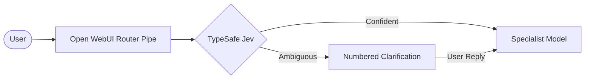

# Universal Open WebUI Router — TypeSafe Jev Boilerplate

**Request**: A simplified, universal boilerplate for an Open WebUI router pipe using pure TypeSafe Jev, with clean minimal code, concise explanations, fast unit tests, sample evals, and an AI agent instructions guide so agents can easily recreate or customize it.  

---

## What it does

Adds a single unified "Front Door" model to Open WebUI (**Universal Assistant Router**), implemented as a native *pipe* function:

1. **Access Check**: Filters available specialist models using the caller's own permissions from `/api/models`.
2. **TypeSafe Jev Routing**: Queries TypeSafe System One (`/v1/systemone`) with speculative Choice (`agent`) and Noul (`follow_up`) questions.
3. **Override Bypass**: Explicit `/prefix` commands (e.g. `/code`, `/data`, `/write`) bypass the router with zero latency.
4. **Follow-Up Stickiness**: Ongoing conversations stick to the active specialist model.
5. **Clarification with History Rewinding**: When confidence is low, asks a numbered question. When the user picks an option, it rewinds the history and sends the *original* user question to the chosen agent.
6. **Streaming & Citations**: Dispatches to the specialist via Open WebUI's `/api/chat/completions`, streaming text chunks and knowledge citations in real-time.



---

## Files

| File | Purpose |
|---|---|
| `AGENTS.md` | **Agent recreation manual**: architecture specs, Jev API contract, decision cascade, and step-by-step instructions for AI agents. |
| `dist/router_pipe.py` | **The deployable**: Single self-contained Python file to paste into Open WebUI Admin → Functions. |
| `src/route.py` | Pure routing logic (Python standard library only): state builder, Jev client, decision table, clarify resolver. |
| `src/pipe_body.py` | Open WebUI `Pipe` class: valves, access check, SSE streaming proxy, loopback protection. |
| `src/agents.json` | Default agent registry (Code, Data, Writing, General) with targets, overrides, and route criteria. |
| `src/build_pipe.py` | Compiler script: inlines sources into `dist/router_pipe.py` with syntax verification. |
| `tests/test_router.py` | Fast unit tests (10 tests, <1s) verifying overrides, follow-up, decisions, clarify flow, and access filtering. |
| `eval/samples.jsonl` | 12 representative test turns across domains for quick evaluation. |

---

## How it was tested

1. **Build check**:
   ```bash
   python src/build_pipe.py
   ```
   Output: `Successfully built router_pipe.py (25,351 bytes, hash: 047f1ca9d952)`.

2. **Unit test suite**:
   ```bash
   python -m unittest tests/test_router.py
   ```
   Output: `Ran 10 tests in 0.531s — OK`.

---

## Production Deployment (Open WebUI)

### 1. Customization (Pre-install)
1. Edit `src/agents.json`:
   - Set each `target` to your real Open WebUI model id (found in **Workspace → Models** or model URL).
   - Adjust `route_criteria` (`what`, `not_for`, `examples`) to match your organization.
2. Run `python src/build_pipe.py` to regenerate `dist/router_pipe.py`.

### 2. Install Function in Open WebUI
1. Navigate to **Admin Panel → Functions**.
2. Click **+** (Add Function).
3. Paste the contents of `dist/router_pipe.py`.
4. Click **Save** and toggle the function **ON**.

### 3. Configure Valves
Click the gear icon next to the function:
- `TYPESAFE_API_KEY`: Enter your TypeSafe API key.
- `OWUI_BASE_URL`: Set to `http://localhost:8080` (or your internal container URL).
- `SHOW_LABEL`: Set to `true` to display "Answered by: [Model]" badges above messages.

### 4. Set Interface Defaults
1. Under **Admin Panel → Settings → Interface**:
   - Set **Default Model** to `Universal Assistant Router`.
2. Under **Workspace → Models**:
   - Edit each specialist model, set **Access** permissions, and toggle **Hide from UI** (so only the router appears in the chat dropdown).

---

## Rollback

To rollback:
1. Go to **Admin Panel → Functions** and toggle `Universal Assistant Router` **OFF**.
2. Unhide specialist models in **Workspace → Models** so users can select them directly.
